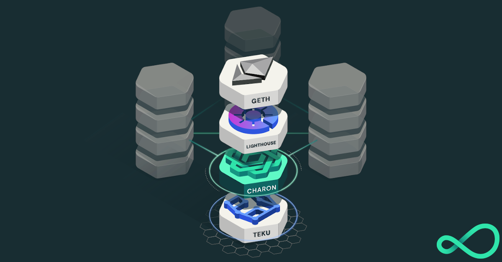

<h1 align="center">Charon Distributed Validator Node</h1>

This repo contains the [docker-compose](https://docs.docker.com/compose/) files needed to run one node in a [charon](https://github.com/ObolNetwork/charon) [Distributed Validator Cluster](https://docs.obol.org/docs/int/key-concepts#distributed-validator-cluster).

A distributed validator node is a machine running:

- An Ethereum Execution client
- An Ethereum Consensus client
- An Ethereum Distributed Validator client
- An Ethereum Validator client



# Quickstart

Check the Obol [docs](https://docs.obol.org/docs/start/quickstart_overview) for detailed instructions on how to get started using this repo.

# Versioning

It is recommended to use a stable version of the codebase. Major and minor versions follow those of Charon itself (i.e.: latest `v1.6.X` of CDVN will reflect latest `v1.6.Y` Charon), but patch versions in CDVN might be higher (i.e.: `v1.6.2` of CDVN has (latest) `v1.6.1` of Charon).
This is done with mind, that small improvements on CDVN can be made without being tied to a Charon release.

# Adding Validators

Starting with charon v1.6, you can add validators to your cluster using the `charon alpha add-validators` command. Note that this is an experimental feature and should not be used in production (Mainnet). The example below is designed for the default configuration provided by this repository and assumes the stack uses the Lodestar validator client.

1. Review the `add-validators` command [CLI reference](https://docs.obol.org/next/learn/charon/charon-cli-reference).
2. Ensure this folder contains a valid `.charon` directory currently used by the running node. Keep the DV node running during the process.
3. Run the following command to collectively generate and add 10 new validators with other node operators (similar to DKG):

```sh
# If you prefer running a pre-built charon binary
charon alpha add-validators --num-validators 10 --withdrawal-addresses=0x<your_withdrawal_address> --fee-recipient-addresses=0x<your_fee_recipient_address> --output-dir=output

# Or, if you prefer running it using Docker
# (replace 'latest' with the most recent version if needed: https://hub.docker.com/r/obolnetwork/charon/tags)
docker run --rm -v "$(pwd):/opt/charon" obolnetwork/charon:latest alpha add-validators --num-validators 10 --withdrawal-addresses=0x<your_withdrawal_address> --fee-recipient-addresses=0x<your_fee_recipient_address> --data-dir=/opt/charon/.charon --output-dir=/opt/charon/output
```

This command will create a new cluster configuration that includes both existing and new validators. It will also generate the necessary keys for the new validators and deposit-data files. A new configuration will be saved in the `output` directory.

4. To start using the new configuration (with the added validators), stop the current charon and validator client instances:

```sh
docker compose stop charon lodestar
```

5. Back up and remove the existing `.charon` directory, then move the `output` directory to `.charon`:

```sh
mv .charon .charon-backup
mv output .charon
```

6. Restart the charon and validator client instances:

```sh
docker compose up -d charon lodestar
```

Lodestar's boot script (`lodestar/run.sh`) will automatically import all keys, removing any existing keys and cache. Charon will load the new `cluster-lock.json` and recognize all validators in the cluster.

Steps 4–6 must be performed independently by all node operators, likely at different times. During this process, some nodes will use the old configuration and others the new one. Once the number of upgraded nodes reaches the BFT threshold, the newly added validators will begin participating in the cluster.

## Current limitations:

- The new cluster configuration will not be reflected on the Launchpad.
- The new cluster configuration will have a new cluster hash, so the observability stack will display new cluster data under a different identifier.
- The `add-validators` command supports the KeyManager API (similar to the `dkg` command). However, it may not have direct access to the original private keys if they're no longer in the `.charon` folder you are adding validators to. In this case, it cannot produce valid cluster lock signatures, so you must use the `--unverified` flag. This means charon does not hash and sign the new cluster lock file with all the private keys to prove their existence. As a result, you need to add the `--no-verify` flag or set the `CHARON_NO_VERIFY=true` environment variable to the `charon run` command/container.
- If you use different validator clients, review the keys import script. The old keys in `.charon/validator_keys` remain unchanged, so verify that importing the same keys will not disrupt the validator client's state.

# Multi-client CDVN

Default CDVN is available with the following stack:

- Execution layer: Nethermind
- Consensus layer: Lighthouse
- Distributed validator: Charon
- Validator cllient: Lodestar
- MEV: MEV-boost

Our focus at Obol being decentralisation, CDVN can also run with multiple clients. We will slowly be rolling out support for different EL, CL, VC and MEV clients.

## Migrating as an existing CDVN user

In order to migrate a currently running Nethermind-Lighthouse-Charon-Lodestar-MEVBoost setup to multi-client one, the `.env` should be updated.

1. Copy the new `.env.sample.<NETWORK>` file to `.env`. Make sure custom environment variables are not lost in the process.

  > [!IMPORTANT]  
  > Some environment variables were renamed in order to be client-agnostic. If you have set those environment variables to custom values, after migrating to the multi client setup, use the new ones. They serve the same purpose.
  >
  > | Old                           | New                              |
  > |-------------------------------|--------------------------------- |
  > | NETHERMIND_PORT_P2P           | EL_PORT_P2P                      |
  > | NETHERMIND_IP_HTTP            | EL_IP_HTTP                       |
  > | NETHERMIND_PORT_HTTP          | EL_PORT_HTTP                     |
  > | NETHERMIND_IP_ENGINE          | EL_IP_ENGINE                     |
  > | NETHERMIND_PORT_ENGINE        | EL_PORT_ENGINE                   |
  > | LIGHTHOUSE_PORT_P2P           | CL_PORT_P2P                      |
  > | LODESTAR_PORT_METRICS         | VC_PORT_METRICS                  |
  > | MEVBOOST_TIMEOUT_GETHEADER    | MEV_TIMEOUT_GETHEADER            |
  > | MEVBOOST_TIMEOUT_GETPAYLOAD   | MEV_TIMEOUT_GETPAYLOAD           |
  > | MEVBOOST_TIMEOUT_REGVAL       | MEV_TIMEOUT_REGVAL               |
  > | MEVBOOST_RELAYS               | MEV_RELAYS                       |
  > | NETHERMIND_PROMTAIL_MONITORED | EL_NETHERMIND_PROMTAIL_MONITORED |
  > | LIGHTHOUSE_PROMTAIL_MONITORED | CL_LIGHTHOUSE_PROMTAIL_MONITORED |
  > | LODESTAR_PROMTAIL_MONITORED   | VC_LODESTAR_PROMTAIL_MONITORED   |
  > | MEV_BOOST_PROMTAIL_MONITORED  | MEV_MEV_BOOST_PROMTAIL_MONITORED |

2. Stop the existing cluster.

```sh
docker compose --profile "" down
```

3. Start the new cluster.

```sh
docker compose up -d
```

## Switch consensus layer client

1. Stop the existing consensus layer client container.
> [!TIP]
> If you do not want to experience downtime while the new beacon node is syncing, you can set a fallback beacon node for Charon (`CHARON_FALLBACK_BEACON_NODE_ENDPOINTS` env variable) that will be used while the new BN is syncing.

```sh
docker compose down cl-lighthouse
```

2. Update the `CL` environment variable to a different supported consensus layer client (i.e.: `cl-grandine`). In the `.env` are listed the currently supported clients.

3. Start the new consensus layer client container.

```sh
docker compose up cl-grandine -d
```

4. Restart Charon in order to update the BN it's querying.

```sh
docker compose down charon
docker compose up charon -d
```

5. After the new beacon node is synced and you are assured the new setup is working, you can delete the previous BN's data in order to save resources

```sh
rm -rf ./data/lighthouse
```

## Switch validator client

> [!NOTE]
> There is currently an incompatibility between validator clients that may cause attestation aggregation duties to fail. Aggregation duties are not economically rewarded nor punished for their completion.
>
> To ensure aggregations succeed; have at least threshold of nodes in the cluster running one of Lodestar, Lighthouse, and Nimbus, or alternatively; have a threshold of nodes in the cluster running one of Teku and Prysm. This incompatibility will be remediated in upcoming client releases.
>

1. Stop the existing validator client container.

```sh
docker compose down vc-lodestar
```

2. Update the `VC` environment variable to a different supported validator client (i.e.: `vc-nimbus`). In the `.env` are listed the currently supported clients.

3. Start the new validator client container.

```sh
docker compose up vc-nimbus -d
```

4. After the new validator client is started and you are assured the new setup is working, you can delete the previous VC's data in order to save resources

```sh
rm -rf ./data/lodestar
```

## Switch MEV client

0. If switching to commit-boost, you will need to copy a commit-boost TOML config `commit-boost/config.toml.sample.<NETWORK>` to `commit-boost/config.toml` , as it does not support `.env` configurations yet. Make sure the configuration matches what you have had set for mev-boost, in terms of relays and timeouts.

1. Stop the existing MEV client container.

```sh
docker compose down mev-mevboost
```

2. Update the `MEV` environment variable to a different supported MEV client (i.e.: `mev-commitboost`). In the `.env` are listed the currently supported clients.

3. Start the new MEV client container.

```sh
docker compose up mev-commitboost -d
```

4. Restart the beacon node in order to update the MEV it's querying.

```sh
docker compose down cl-grandine
docker compose up cl-grandine -d
```

# Security

- **Grafana is only published on `127.0.0.1`.** To view it from another machine, use an SSH tunnel: `ssh -L 3000:127.0.0.1:3000 <user>@<node>`, then open `http://localhost:3000`. Anonymous visitors get read-only access, and password logins are disabled because dashboards and datasources are provisioned from this repo.
- **Docker-published ports bypass host firewalls such as `ufw`.** Only bind a port to a non-loopback address (e.g. `MONITORING_IP_GRAFANA`, `EL_IP_HTTP`) if a provider or network firewall restricts who can reach it. By default only the P2P ports are published on all interfaces.
- **Avoid descriptive hostnames.** DNS names and TLS certificates naming the network or what the node runs (e.g. `mainnet`, `validator`) make a node easy to find with internet-wide scans.
- **If you ran a release before the Grafana hardening,** Grafana now starts from a fresh Docker volume and no longer uses `data/grafana`. After upgrading, run `./grafana/security-check.sh` (it may need `sudo`). It reports whether Grafana is published on a public address. It lists anything in the old `data/grafana` that this stack does not create, such as service accounts, tokens, users, datasources, plugins, organizations, dashboards, alert rules and contact points. It also lists changed or added files under `grafana/`, which older releases mounted writable. Report findings to security@obol.tech, then delete `data/grafana`. Grafana stores secrets with a default encryption key, so if your Grafana was reachable, rotate any credentials you stored in it, such as webhook URLs or tokens used by contact points.
- **Upgrading leaves the old Grafana database behind.** Anything created in the Grafana UI, such as custom dashboards, alert rules, contact points or users, stays in the unused `data/grafana` and does not carry over to the fresh Grafana. Before upgrading, export any custom dashboards (Share > Export) and note your alert rules. Do not copy the old database across, as it may contain unauthorized changes. To set customizations up again, add dashboards as JSON files under `grafana/dashboards/`, or re-enable logins with your own admin password in a `docker-compose.override.yml`, adding `:docker-compose.override.yml` to the end of `COMPOSE_FILE` in `.env` so it is loaded:

  ```yaml
  services:
    grafana:
      environment:
        GF_AUTH_DISABLE_LOGIN_FORM: "false"
        # Visitors must log in to see anything.
        GF_AUTH_ANONYMOUS_ENABLED: "false"
        GF_SECURITY_ADMIN_PASSWORD: "<a strong password>"
        # Generate with: openssl rand -hex 32
        GF_SECURITY_SECRET_KEY: "<your own random key>"
  ```

  **Set the admin password before you restart with this override.** `GF_SECURITY_ADMIN_PASSWORD` only applies when Grafana creates its database, and your Grafana has most likely already created it with the default `admin` / `admin`. Run `docker compose exec grafana grafana cli admin reset-admin-password '<a strong password>'` first, then `docker compose up -d`.

  `GF_SECURITY_SECRET_KEY` replaces Grafana's publicly known default key for encrypting stored secrets, such as the webhook URLs and tokens of contact points. Set it before adding any. Changing it later makes the secrets already stored unreadable, and you'll have to enter them again.

  Keep Grafana bound to `127.0.0.1` and reach it through an SSH tunnel. Logins go over plain HTTP, so only bind it elsewhere behind a provider or network firewall.

# FAQs

Check the Obol docs for frequent [errors and resolutions](https://docs.obol.org/docs/faq/errors)
